# Postio architecture

How Postio is put together. The rules are in `.specify/memory/constitution.md`;
long-form decisions are the ADRs in [`docs/decisions/`](decisions/README.md).

## The shape

```mermaid
graph TD
    app["<b>postio-gtk</b><br/><i>Postio, the desktop app — Linux</i><br/>one dense inbox · markers · digests · filtering<br/><i>its own code: no SQL · no protocol</i>"]
    mac["<b>macos/</b><br/><i>Swift package — macOS</i><br/>SwiftUI · AppKit · WKWebView"]
    tui["<b>postio-tui</b><br/><i>terminal binary</i><br/>ratatui · crossterm · Markdown in and out"]
    mcp["<b>postio-mcp</b><br/><i>MCP server binary — ADR 0010</i><br/>stdio · reads and drafts, never sends"]
    host["<b>postio-host</b><br/><i>in each app's process</i><br/>every store operation, once · sync · upkeep"]
    client["<b>postio-client</b><br/>Req/Resp · commands down, events up<br/><i>no engine — CI enforced</i>"]
    session["<b>postio-session</b><br/><i>composition root — no toolkit</i><br/>store · runtime · engines · the verb vocabulary<br/><i>no GTK — CI enforced</i>"]

    subgraph view ["frontends"]
        widgets["<b>postio-widgets</b><br/>what the desktop app draws outside its window<br/>message view · composer · keycaps · chips<br/><i>no store · no protocol · no host · no app</i>"]
        ffi["<b>postio-ffi</b><br/>the UniFFI boundary<br/><i>ADR 0019 · what crosses to Swift</i>"]
        ui["<b>postio-ui</b><br/>presentation with no toolkit in it<br/>keymap · list window · reader document · tokens<br/><i>called by both — no GTK, no SQL</i>"]
    end

    subgraph engine ["the database half"]
        runtime["<b>postio-runtime</b><br/>queue drainer · body backfill · reconnect"]
        sync["<b>postio-sync</b><br/>operation queue · QRESYNC · IDLE · backoff"]
        imap["<b>postio-account</b><br/>io-imap behind MailBackend"]
        smtp["<b>postio-smtp</b><br/>io-smtp"]
        storage["<b>postio-storage</b><br/>Turso · migrations · blob store"]
        index["<b>postio-index</b><br/>full-text index · executor"]
    end

    subgraph contract ["contract"]
        core["<b>postio-core</b><br/>commands · events · registry · undo · bridge<br/><i>no GTK — CI enforced</i>"]
        config["<b>postio-config</b><br/>TOML schema · validation · live reload"]
    end

    subgraph domain ["domain"]
        search["<b>postio-search</b><br/>query parser · highlighter · facets<br/><i>pure — no SQL, no toolkit</i>"]
        body["<b>postio-body</b><br/>Document · HTML subset · quoting · sanitising<br/><i>owns ammonia — both directions</i>"]
        model["<b>postio-model</b><br/>domain types · JWZ threading"]
    end

    focus["<b>postio-focus</b><br/>the Focus controller: cursor · surfaces · keys · intents<br/><i>no I/O · ADR 0045</i>"]

    subgraph focusdomain ["Focus's engine work"]
        classify["<b>postio-classify</b><br/>filter · hold · mark, in layers<br/><i>no send path · no network</i>"]
        calendar["<b>postio-calendar</b><br/>invitations · RSVP replies<br/><i>pure leaf</i>"]
        ai["<b>postio-ai</b><br/>the user's own model, on this computer<br/><i>no send path · no store · no model</i>"]
        vault["<b>postio-vault</b><br/>Obsidian tasks and notes<br/><i>files only · no network</i>"]
    end

    app --> session
    app --> widgets
    app --> focus
    tui --> focus
    ffi --> focus
    focus --> client
    focus --> ui
    focus --> core
    focus --> vault
    app --> ui
    app --> core
    app --> search
    app --> body
    app --> config
    app --> vault
    mac --> ffi
    ffi --> host
    ffi --> client
    ffi --> session
    ffi --> ui
    ffi --> core
    app --> host
    app --> client
    tui --> client
    tui --> host
    mcp --> client
    mcp --> host
    mcp --> body
    host --> session
    host --> client
    host --> ai
    host --> calendar
    host --> vault
    client --> core
    session --> runtime
    session --> core
    widgets --> core
    widgets --> client
    widgets --> body
    ui --> core
    ui --> search
    ui --> body
    ui --> model
    runtime --> sync
    runtime --> index
    runtime --> core
    runtime --> storage
    sync --> imap
    sync --> smtp
    sync --> storage
    sync --> classify
    ai --> classify
    ai --> config
    classify --> search
    calendar --> model
    vault --> model
    index --> search
    index --> model
    core --> config
    core --> model
    search --> model
    body --> model
    storage --> model
    imap --> model
    smtp --> model

    classDef pure fill:#eef3f8,stroke:#5980a6,color:#1c2b3a
    classDef guard stroke-dasharray:4 3,stroke:#5980a6
    class model,search,calendar pure
    class core,app,focus,session,client,tui,mcp,widgets,classify,ai,vault guard
```

Arrows are "depends on" and each is a real direct dependency. Omitted:
`postio-session`'s edges to most leaves (it is the composition root), edges
implied by a longer path, and `postio-workspace-hack`, which every crate
depends on and which has no code (ADR 0047).

## Crates

| Crate | Role |
|---|---|
| `postio-gtk` | The desktop app (Focus design, binary `postio`, app id `dev.postio.Postio`). A window, its rows and dialogs; each names a widget. No SQL, no protocol. |
| `postio-widgets` | The GTK the app draws outside its window: message view, composer, keycaps, chips, pickers, settings. |
| `postio-focus` | The Focus controller: cursor, selection, surface stack, key resolver. Does no I/O. Frontends feed it inputs and draw its intents (ADR 0045). |
| `postio-tui` | The terminal app (ratatui, crossterm). Drives the `postio-focus` controller like the GTK and macOS frontends. |
| `postio-ffi`, `macos/` | The UniFFI boundary and the Swift app over it (ADR 0019). |
| `postio-mcp` | The frontend with no screen: MCP over stdio, reads and drafts, never sends (ADR 0010, [`mcp.md`](mcp.md)). |
| `postio-ui` | Presentation with no toolkit: keymap, list window, reader document, tokens, verb scope. No GTK, no SQL. |
| `postio-host` | Every store operation, written once: paging, reading, search, compose, settings, onboarding, sync, upkeep. Runs inside each app's process. |
| `postio-client` | Commands down, events up. The frontends' whole view of mail. No engine. |
| `postio-session` | Composition root: store, runtime, engines, the verb vocabulary. No toolkit. |
| `postio-runtime` | Async runtime, sync and index orchestration. |
| `postio-core` | Commands, events, registry, undo, bridge. No GTK, no optional dependencies. |
| `postio-config` | TOML schema, validation, live reload. |
| `postio-search` | Query parser, highlighter, facets. Pure. |
| `postio-body` | Document, HTML subset, quoting, sanitising (ammonia, both directions). Pure leaf. |
| `postio-model` | Domain types, JWZ threading. |
| `postio-storage`, `postio-index` | The store (Turso, ADR 0038) and the search index. |
| `postio-sync`, `postio-transport`, `postio-gmail`, `postio-jmap`, `postio-smtp` | Sync over the `MailBackend` trait; protocol crates. |
| `postio-classify` | Filter, hold, mark, in layers. No send path, no network. |
| `postio-calendar` | Invitations and RSVP replies. Pure leaf. |
| `postio-ai` | Asks the user's own model, on this computer. No send path, no store, no model. |
| `postio-vault` | Appends Markdown to an Obsidian vault. Files only. |
| `postio-render` | The memory-safe reading renderer (ADR 0042). |

Other crates (account, contact-sync, extract, vcard, demo, bench, storyboard,
test-support) are support code.

## Boundaries

`scripts/checks/check-crate-boundaries.py` enforces them against
`cargo metadata`'s resolved graph, dev-dependencies included. Dashed boxes
above are the guarded crates. A boundary is what a crate's code can call, so
the check does not walk into `postio-workspace-hack`.

- `postio-core` and `postio-session` take no GTK. `postio-core` has no
  optional dependencies: features unify across the build, so a
  `postio-core/runtime` feature would put the engine in every crate's graph.
- An interface (`postio-gtk`, `postio-tui`, `postio-ffi`) takes no store
  engine and no mail protocol as a direct dependency; it opens the store
  through `postio-host` (ADR 0041). `rusqlite` stays banned beside `turso`.
- `postio-client` takes no toolkit, WebKit, store engine or protocol.
  `postio-tui` takes no toolkit or WebKit.
- `postio-widgets` takes no store engine, protocol, store-owning crate
  (`postio-host`, `postio-session`, `postio-runtime`, `postio-storage`,
  `postio-sync`) or app (ADR 0043).
- `postio-classify` takes no send path or network crate (ADR 0009).
  `postio-calendar` takes no store engine, toolkit, async runtime or network.
- `postio-ai` takes no send path, store, toolkit, inference engine or HTTP
  client but `io-http`; its endpoint can only name this computer.
- `postio-vault` takes no network crate, toolkit, store engine or async
  runtime.
- `postio-mcp` takes no store engine, protocol, toolkit, WebKit, inference
  engine or HTTP/WebSocket server. Its only transport is stdio.
- No app binary links an inference engine.
- `postio-model`, `postio-search`, `postio-body`, `postio-config` and
  `postio-sync` have the narrower rules in the check's table.
- `scripts/issue-land.sh` refuses a changed crate the host cannot build,
  probing `pkg-config`, not `uname`. The GTK crates are the portable half's
  exclusion set (`postio-gtk`, `postio-widgets`).

One app opens the store at a time (ADR 0041). Each runs `postio-host` in its
own process; the first to start holds the store. An agent reaches the holder
over its private agent socket instead of opening the store.

**Verb scope** is decided in one place: `postio_ui::scope::target` resolves
whether a key acts on a message or a thread, and `scope::footer` says so. No
frontend decides scope itself; a new verb that acts on mail gets a row in that
table and a test per cell.

**Frontend coverage is a test.** `postio-ffi`'s `command_coverage.rs` fails
when a registry command reaches no boundary, bus or window unless listed as
debt with an issue. `focus_suite`'s `every_command` presses every bound command
and fails on one with no visible effect that `storyboards/gaps/focus.toml`
does not name.

## The decisions

The numbered sections are cited from code; each is one line and a home.

1. **§1.** Commands down, events up; the UI never awaits the network. Store write, enqueue, emit, repaint; `postio-core::bridge` is the only place the tokio half meets the UI loop, over unbounded channels. (constitution I.)
2. **§2.** The registry is the source of truth for every command surface; a command not in it does not exist. (constitution II, ADR 0002 (the extension-command layer is removed).)
3. **§3.** Command ids are a file format: `[keys]` in `config.toml` is keyed by them. (constitution II.)
4. **§4.** Selection is a predicate, not a list, and not the cursor. (constitution II.)
5. **§5.** Undo replays inverses through the same machinery as the original action. (`postio-core`.)
6. **§6.** One matching language for searches, saved searches, virtual folders and filters. (constitution III, ADR 0008, ADR 0025, ADR 0027.)
7. **§7.** Providers are data, not code. (constitution VII, ADR 0006.)
8. **§8.** The protocol crate is held at arm's length: `postio-sync` talks to `MailBackend`, never to `io-imap` types. (ADR 0001.)
9. **§9.** The crate boundaries are enforced, not encouraged (the Boundaries section above). (constitution VII, ADR 0041, ADR 0043, ADR 0047.)
10. **§10.** Design tokens are generated from `Design/_ds` into `postio_ui::tokens` and checked in; drift tests fail on a stale copy. Colour comes from libadwaita's named colours. (`postio-ui`.)
11. **§11.** Privacy is a feature, not a setting. Script never touches message content, in either direction. (constitution VI, ADR 0042, ADR 0010.)
12. **§12.** No AI inside Postio; a user-run local model is optional. (constitution (Additional Constraints), ADR 0009.)
13. **§13.** The composer's document (`postio_body::Document`) is not the toolkit's buffer; each platform's editor is a view over it. Sanitisation is bidirectional. (ADR 0004, ADR 0039.)
14. **§14.** Content identity is distinct from mailbox identity. (ADR 0046.)

Also: [ADR 0020](decisions/0020-where-message-bodies-live.md) (where bodies
live), [ADR 0013](decisions/0013-event-fanout.md) (event fan-out),
[ADR 0021](decisions/0021-exactly-once-send.md) (exactly-once send),
[ADR 0040](decisions/0040-the-store-keeps-few-connections-maintains-its-counts-and-budgets-its-index.md)
(store connections and counts), [ADR 0049](decisions/0049-each-layer-asserts-its-own-question.md)
(each layer asserts its own question).
